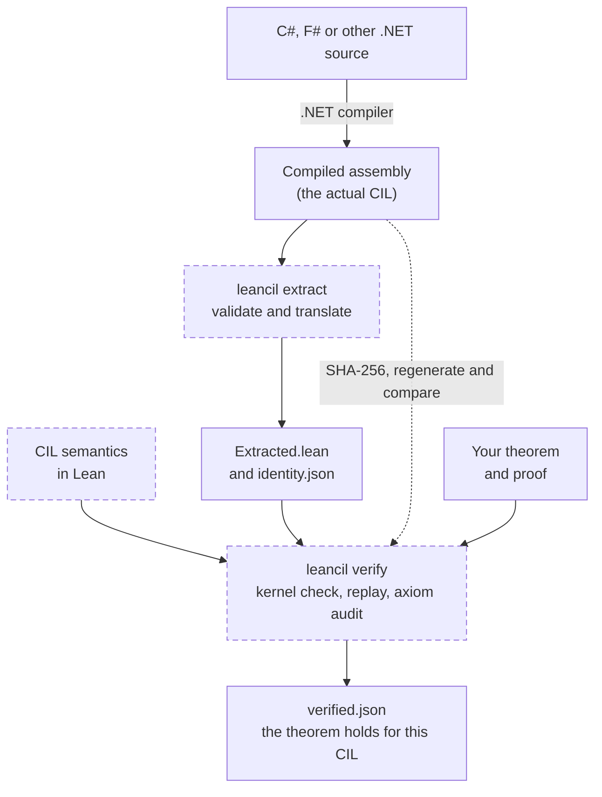

# LeanCIL: Formal Verification for .NET


LeanCIL uses Lean 4 to prove properties of compiled .NET code. It extracts Common Intermediate
Language (CIL) from assemblies written in C#, F# and other .NET languages, then checks proofs
against an explicit model of those instructions.

You can prove results for every input satisfying a contract, show that a loop terminates,
check memory access conditions, or establish a counterexample to an incorrect implementation.
Proofs can compose previously proved method contracts without unfolding helper bodies.

The [buffer-fill example](Examples/Proofs/FillWords.lean) proves an arbitrary-length fill,
including termination, the resulting contents and preservation outside the writable region.
The [span-content loop](Examples/Proofs/SpanAllZero.lean) proves whether every element is zero
over arbitrary-length symbolic caller storage, including termination and exact memory preservation.



The guarantee is exactly the proved theorem, including its preconditions and quantifiers.
Lean checks the proof. It does not check whether the theorem's statement captures your
intended specification.
The extractor, CIL model and verification machinery have an explicit
[trust boundary](docs/SOUNDNESS.md); LeanCIL does not claim complete CLR or JIT verification.

## Quick start

Install **Lean 4.35.0** through elan and **.NET SDK 10.0.403**, as pinned in
[lean-toolchain](lean-toolchain) and [global.json](global.json). From this checkout:

```sh
dotnet pack Extractor -c Release -o artifacts/packages
dotnet tool update --global Nethermind.LeanCIL --add-source artifacts/packages --prerelease
```

The example assembly contains:

```csharp
public static ulong Add(ulong x, ulong y) => unchecked(x + y);
```

Build it, extract its compiled instructions and check the supplied universal addition proof:

```sh run
dotnet build Examples/Assembly -c Release
leancil extract Examples/Assembly/bin/Examples.dll "Arithmetic::Add(ulong,ulong)" artifacts/Add
leancil verify artifacts/Add --proof Examples/Proofs/Add.lean
```

Success prints `Verified: ExampleProof.correctness` and writes `artifacts/Add/verified.json`. The
theorem states that the result equals `(x + y) mod 2^64` for every pair of 64-bit inputs. Changing
the implementation to subtraction makes the unchanged proof fail.

The [getting-started walkthrough](docs/GETTING-STARTED.md) shows the expected output, a failing
proof and its recovery, and a proof that an invalid memory access cannot succeed. The
[examples](docs/EXAMPLES.md) cover arithmetic, calls, structs, classes and virtual calls, strings,
generic methods, loops, memory access and compiled F#.

## Commands

| Command | Purpose |
| --- | --- |
| `leancil list` | Discover canonical method signatures in an assembly |
| `leancil extract` | Validate and translate a method and its reachable calls |
| `leancil blockers` | Report every construct that stops extraction of a list of methods |
| `leancil check` | Check extraction artifacts against their assembly and settings |
| `leancil new-proof` | Write a starting proof, with its holes marked, for an extraction |
| `leancil verify` | Check, kernel-replay and audit a named theorem |
| `leancil workspace` | Generate a method's extraction into the proof's package for live editor goals |
| `leancil watch` | Rebuild C# on change, refresh the changed extractions and verify the affected proofs |
| `leancil verify-batch` | Verify multiple requests against one consumer snapshot |
| `leancil gates` | Build, extract and verify a catalog of methods, profiles, proofs and regression variants, or plan it over CI jobs |
| `leancil bindings` | Generate the proof sources of a binding catalog, or check them |
| `leancil export-contracts` | Publish verified method contracts for separately compiled callers |
| `leancil audit-library` | Kernel-replay and axiom-audit the theorems of a Lean library |

`verify --goals` prints the goal at each `sorry` and failing tactic of an unfinished proof. A
failing command returns a nonzero exit code. See the [CLI reference](docs/CLI.md) for every
command and option, profiles, saved settings and diagnostics.

## Consumer packages and batches

Keep application specifications and proofs in your own Lean package, with LeanCIL pinned as
a dependency. Methods can publish contracts for separately compiled callers; consumer proofs
can span multiple modules and share checked support across batch requests. Alternatively,
`extract --reference Lib.dll` pins a referenced assembly by SHA-256 and extracts its bodies
into one program; see [referenced assemblies](docs/CLI.md#extract-from-referenced-assemblies).

See [consumer packages and workspaces](docs/CONSUMERS.md) and
[contract interfaces](docs/CONTRACT-INTERFACES.md).
Lake configuration and Lean elaborators execute code, so use packages you trust.

## Supported subset and limits

LeanCIL supports integer arithmetic, selected control flow and managed calls, reference-free
structs, checked memory access, and arrays and spans of integers, enums,
reference-free structs and supported integer vectors over supplied storage,
reference-free array allocation, typed managed dispatch, and selected runtime helpers and
SIMD intrinsics.

It also supports classes deriving from `System.Object` through admitted classes, created on a
budgeted heap, with scalar fields, reference fields holding class instances, and fields holding
arrays of class references or single-dimensional arrays of integers, Booleans, chars, enums,
reference-free structs or integer vectors. A `callvirt` of a virtual method dispatches over the
extracted classes on the receiver's runtime type, and `castclass` and `isinst` decide an admitted
class from the instance's lineage. One-dimensional arrays of class references are allocated,
loaded and stored with the runtime's covariance check.
Strings, including interned literals, and classes outside the model are opaque references that
are passed, stored, compared and tested against null but never read. Framework argument guards
such as `ArgumentNullException.ThrowIfNull` are checked as runtime contracts.

Each has restrictions documented in the [opcode support table](docs/OPCODES.md) and
[intrinsic support tables](docs/SIMD.md). Unsupported instructions and signatures are rejected
explicitly.

The checked memory model tracks allocation identity, lifetime, bounds, permissions,
initialization and alignment. `CIL.Safety.invoke` is the execution model for both functional
correctness and memory-safety claims.

Other classes and field types, arrays of references other than one-dimensional arrays of
admitted classes or of non-generic classes such as `string`, reading a string's characters,
virtual dispatch outside the extracted classes, interface calls, type tests against interfaces,
`System.Object` or value types, boxing, ordinary recursive calls, exception handlers,
floating-point arithmetic and arbitrary external calls are outside the supported subset.
Concurrency, GC implementation correctness and equivalence to arbitrary .NET runtimes are
outside the model's guarantees. See [soundness and limitations](docs/SOUNDNESS.md).

## Build and test

```sh
lake build
dotnet run --file scripts/Test.cs -- --suite core
```

These commands are for working on LeanCIL itself; using the tool needs neither. Run
`dotnet run --file scripts/Test.cs` for the full suite. Results are written to `artifacts/`; use
separate checkouts for concurrent suites because they mutate those files. See [validation coverage
and suite commands](docs/VALIDATION.md) and [CI operation](docs/CI.md).

## Documentation

| Topic | Guide |
| --- | --- |
| First proof and failure diagnostics | [Getting started](docs/GETTING-STARTED.md) |
| Every command, option and report | [CLI reference](docs/CLI.md) |
| Complete example proofs | [Examples](docs/EXAMPLES.md) |
| Proofs in your own Lake package, batches and editor workspace | [Consumer packages](docs/CONSUMERS.md) |
| Proofs, contracts, loops and automation | [Writing proofs](docs/PROOFS.md) |
| Supported instructions and intrinsics | [Opcodes](docs/OPCODES.md), [SIMD](docs/SIMD.md) |
| Checking proofs against your library with a coding agent | [Agent skill](skills/leancil/SKILL.md) |
| Modules and proof APIs | [Architecture](docs/ARCHITECTURE.md) |
| Cross-assembly contracts | [Contract interfaces](docs/CONTRACT-INTERFACES.md) |
| Independently checking imported implementations | [Full verification](docs/FULL_VERIFICATION.md) |
| Runtime and architecture assumptions | [Runtime profiles](docs/RUNTIME-PROFILES.md) |
| Trusted components and guarantees | [Soundness](docs/SOUNDNESS.md) |
| Benchmarks and implementation investigations | [Performance](docs/performance/README.md) |

## License

Licensed under either [Apache-2.0](LICENSE-APACHE) or [MIT](LICENSE-MIT), at your option.
