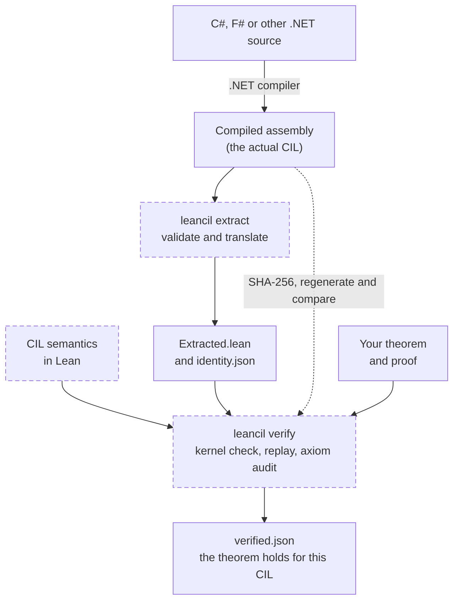

# LeanCIL: Formal Verification for .NET


LeanCIL is a Lean 4 formal verification framework for .NET programs. It enables machine-checked proofs of correctness and safety against compiled Common Intermediate Language (CIL), supporting applications written in C#, F#, and other .NET languages.

Verification operates on the assembly's actual compiled instructions using CIL semantics defined in Lean. The current [supported subset](#supported-subset-and-limits) covers selected instructions and runtime features; unsupported behaviour is rejected explicitly.



Dashed boxes are trusted rather than proved; see the [trusted computing base](docs/SOUNDNESS.md#trusted-computing-base). They are the extractor's metadata decoding and instruction translation, the CIL semantics as a model of .NET 10, and the Lean kernel with the verifier's hashing and process execution. Lean independently checks the extractor's layout, generic-specialization and feature evidence, but not the general translation. The compiler is not trusted: extraction reads its actual output. The kernel checks your proof but not your statement, so the guarantee is exactly what the theorem says, including its preconditions.

Generated external-call identities use shared, kernel-checked UTF-8 chunks. This avoids
re-encoding long assembly-qualified signatures while retaining exact byte identities and
all translation validators. See [validation coverage](docs/VALIDATION.md) for the fixed-input
compilation and replay benchmark.

## Build and test

Caller proofs can register proved interfaces with `@[cil_contract]` and use
`cil_contract_steps` to compose calls. The stepper checks the callee binding and
precondition and exposes the postcondition; it can also reuse proved child invocations.
See [contract composition](docs/PROOFS.md) for explicit and automatic call proofs.

Feature and division getter recognition use exact byte comparisons with kernel-checked
equivalence to their original signature rules. This reduces certificate replay work while
preserving metadata rejection. Feature-flow checks share an indexed classification of local
types and address exclusions, proved equivalent to the original metadata scans.
Managed-call certificates use structural equality proofs for
matching metadata, reducing repeated string comparisons during replay. Primitive metadata also
shares the exact runtime assembly identity. Reachable external calls reuse their complete
identities as checked UTF-8 byte constants, avoiding repeated decoding in the kernel. See
[certificate validation](docs/PROOFS.md).
Fold discovery indexes local-use counts once and bounds exception-message prefix scans;
both changes have exact equivalence proofs to the original checks.

Install the toolchain selected by `lean-toolchain` (Lean **4.35.0**, through elan) and .NET SDK **10.0.403**. The extractor uses Mono.Cecil; the F# examples also use FSharp.Core. Both packages are pinned in `Directory.Packages.props`. Lean uses Std and Lean, without Mathlib.

```sh
lake build
dotnet run --file scripts/Test.cs
```

The scripts are [.NET file-based apps](https://learn.microsoft.com/en-us/dotnet/core/sdk/file-based-apps), with shared C# logic included directly. No scripting runtime is needed beyond .NET.

Positive array, layout, parameter, generic and static-value evidence shares Lean imports in
generated batches, with independent kernel replay. Rejection batches restore Lean's environment
after each case and require that case's own expected diagnostics. The evidence suite compiles its
regression modules directly against the certified library, avoiding another CIL build.
See [validation coverage](docs/VALIDATION.md) for reproducible measurements.

Core consumer tests batch fixed rejection cases to reuse certified-library setup while keeping
source, environment and cache-invalidation checks isolated. See the reproducible comparison in
[validation coverage](docs/VALIDATION.md).

Prepared certified libraries include canonical fingerprints of their compiled modules.
Consumer verification reuses them only while module bytes and the normalizer match,
avoiding repeated framework serialization even when local receipts are disabled.

The test command builds independent example assemblies, runs Lean semantic tests, extracts actual CIL, proves positive examples, checks semantic counterexamples, rejects malformed/unsupported inputs, and tests artifact identity. Results go to `artifacts/test-results.json`; generated CIL, proof caches and verification reports are ignored by Git.

To run one part of the suite, use `dotnet run --file scripts/Test.cs -- --suite core` (or `cli`, `integer`, `narrow`, `primitive`). Each selection builds its prerequisites and writes `artifacts/test-results-<suite>.json`. Use separate checkouts when running suites concurrently because tests build and mutate artifacts.

## Quick start

Build and install the .NET tool from this checkout:

```sh
dotnet pack Extractor -c Release -o artifacts/packages
dotnet tool install --global Nethermind.LeanCIL --add-source artifacts/packages --version 0.1.0
```

Prove that compiled addition returns the right result for every 64-bit input, change `+` to `-`, and see the same proof fail. This walkthrough also demonstrates a theorem that rules out successful execution of an invalid memory access.

`Examples/Assembly/Methods.cs` includes:

```csharp
public static ulong Add(ulong x, ulong y) => unchecked(x + y);
```

With the `leancil` tool installed, build the example, extract its CIL and verify the addition proof:

```sh
dotnet build Examples/Assembly -c Release
leancil extract Examples/Assembly/bin/Examples.dll "Arithmetic::Add(ulong,ulong)" artifacts/Add
leancil verify artifacts/Add --proof Examples/Proofs/Add.lean
```

Expected output:

```text
Verified: ExampleProof.correctness
  Assembly: Examples, Version=1.0.0.0, Culture=neutral, PublicKeyToken=null
  Entry: System.UInt64 Examples.Arithmetic::Add(System.UInt64,System.UInt64)
  Proof: Examples/Proofs/Add.lean
  Axioms: propext, Quot.sound
  Settings: artifacts/Add/verification.json
  Report: artifacts/Add/verified.json
  Statement:
    ExampleProof.correctness (x y : CIL.W64) :
      ∃ result,
        Except.map Prod.snd
              (CIL.Safety.invoke Extracted.program 4 0
                [CIL.Safety.Value.scalar (CIL.Value.i64 x), CIL.Safety.Value.scalar (CIL.Value.i64 y)] Examples.empty) =
            Except.ok [CIL.Safety.Value.scalar (CIL.Value.i64 result)] ∧
          BitVec.toNat result = (BitVec.toNat x + BitVec.toNat y) % 2 ^ 64
```

Every invocation validates the request's identity and required proof evidence. Authenticated caches can reuse unchanged certified builds; source/hash checks, audits and required kernel replay still apply. Use `--fresh` to bypass proof and support reuse while retaining the source-bound library cache; add `--rebuild-library` to rebuild the library. A failed proof removes the previous verification report. `extract` generates definitions and `check` validates extraction consistency; `verify` establishes the selected theorem about those definitions. Its guarantee is exactly the theorem's statement, including its preconditions and quantifiers.

Eligible standalone proofs, generated batches and consumer groups audit the environment returned
by kernel replay, avoiding a second import. Consumer groups retain each request's theorem and
dependency scope. Duplicate declarations and audits requiring source locations or module metadata
retain the separate audit path; theorem and artifact checks still apply.

List the methods of an assembly with `leancil list`, and check that generated files still match
the assembly and extraction settings without running Lean with `leancil check`:

```sh
leancil list Examples/Assembly/bin/Examples.dll
leancil check artifacts/Add
```

`Examples/Proofs/Add.lean` states the mathematical property independently: the returned word's natural value equals `(x.toNat + y.toNat) % 2^64`. Its universal proof derives execution from the generated program. Changing the implementation to subtraction causes the unchanged addition proof to fail. `WrongAdd.lean` independently proves a counterexample for every successful fuel budget.

### Try breaking the implementation

In `Examples/Assembly/Methods.cs`, change only `Add` to:

```csharp
public static ulong Add(ulong x, ulong y) => unchecked(x - y);
```

Rebuild, regenerate the extraction, and run the unchanged addition proof:

```sh
dotnet build Examples/Assembly -c Release
leancil extract Examples/Assembly/bin/Examples.dll "Arithmetic::Add(ulong,ulong)" artifacts/Add
leancil verify artifacts/Add
```

Verification exits with `1`. Its diagnostic starts with:

```text
Invalid: Lean could not prove the selected theorem.
  Stage: proof checking
  Next: Read the Lean diagnostic below and check the implementation against the stated contract, including its preconditions.
```

The detailed Lean error follows. The contract still requires addition for arbitrary inputs, so the subtraction implementation cannot satisfy this proof. `verification.json` remains; `verified.json` is removed. Restore `x + y`, then repeat the three commands to recover a successful verification without repeating the proof arguments. Running `check` after rebuilding but before extraction instead reports that the assembly has changed and tells you to re-extract.

### Reject an invalid memory access

`PastEnd` advances a reference by one `ulong` and dereferences it. The example caller provides only one eight-byte allocation, so the access falls outside it:

```sh
leancil extract Examples/Assembly/bin/Examples.dll "Arithmetic::PastEnd(ulong&)" artifacts/PastEnd
leancil verify artifacts/PastEnd --proof Examples/Proofs/PastEnd.lean
```

This prints `Verified: ExampleProof.correctness` and the theorem statement: for every fuel budget and result, execution with the example caller memory cannot return `Except.ok result`. Here the verified property is **rejection of the unsafe access**, not a claim that the method is safe. The proof also includes a concrete `.outsideAllocation` fault witness. Its caller memory is fixed; the theorem does not claim the access fails for every possible allocation layout.

`Tests/CliVerification.cs` automates the addition edit/rebuild/failure/recovery sequence in a disposable source copy, then checks this invalid-access theorem. Its imported-helper checks reuse an authenticated compiled base when adding previously uncompiled sources. Each helper is still compiled, kernel-replayed and audited when imported; see [validation coverage](docs/VALIDATION.md).

A verification report identifies the **specific named theorem and its printed type**, not all methods or all inputs automatically. `leancil check` validates extraction artifacts only; `leancil verify` runs the proof. A failed proof returns `1`, prints `Invalid:` and the diagnostic to standard error, and removes the previous verification report.

To prove another method, supply a unique method selector, write a Lean file importing `Extracted`, state a specification and prove it from `Extracted.program`. By default the driver checks `ExampleProof.correctness`; use `--theorem` for another name. `CIL.Safety.Ensures` expresses total correctness with successful finite execution. `VC` and `ensures_of_vc` expose a chosen finite execution condition. Simple concrete tests can use kernel reduction (`rfl`); symbolic checked-model proofs use ordinary Lean reasoning or `cil_checked_steps` from `CIL.Safety.SymbolicExecution`. The older `cil_steps` tactic targets the pure interpreter. Exhaustion and unsupported states are failures.

## Commands

| Command | Purpose |
| --- | --- |
| `leancil list` | List canonical method signatures to copy into `extract` |
| `leancil extract` | Validate a method and its reachable calls and generate `Extracted.lean` |
| `leancil templates` | Generate shared flag/callee templates and exact bindings from checked profile extractions |
| `leancil workspace` | Create an editable Lean package for one method/profile, with pinned imports and PDB symbols |
| `leancil blockers` | Report what blocks extraction for listed method and profile pairs, without proofs |
| `leancil check` | Regenerate the extraction in memory and compare it with the saved files |
| `leancil verify` | Check, kernel-replay and audit a proof, then write `verified.json` |
| `leancil verify-batch` | Verify many requests against one consumer snapshot |
| `leancil audit-library` | Replay a Lake package and audit the axioms of every theorem under namespace prefixes ([details](docs/CONSUMERS.md#library-audits)) |

All commands exit with code `0` on success. Failures print a diagnostic to standard error and exit with code `1`. Failed checks and verification attempts start with `Invalid:` and produce no standard output. For example, if the generated Lean file has been edited:

```text
Invalid: Stale or mismatched verification artifact: artifacts/Add/Extracted.lean differs from regenerated CIL.
  Stage: extraction integrity
  Next: Rerun leancil extract with the intended assembly, method and profile, then rerun this command.
```

The [command-line reference](docs/CLI.md) covers method selectors, assembly identity, saved
settings, profiles, initialization assumptions and diagnostics.

## Consumer packages and batches

For an editor workspace with the selected extraction, pinned imports and portable PDB symbols:

```sh
leancil workspace path/to/Nethermind.Int256.dll 'Nethermind.Int256.UInt256::get_IsZeroOrOne()' --profile scalar --proof proofs/IsZeroOrOne.lean --proof-root . --assume-initialized Nethermind.Int256.UInt256
```

The consumer package and proof must already exist. Reopening checks for stale assembly,
profile, symbols and dependency inputs while preserving editor proof edits.
**Editor checking is not a certificate**; copy the edited proof back and run ordinary
`verify`. See [proof-authoring workspaces](docs/CONSUMERS.md#proof-authoring-workspace).

For proofs split across a consumer's own Lean modules, pass the Lake package root:

```sh
leancil verify artifacts/Add --proof proofs/Add.lean --proof-root . --theorem MyProof.correctness
```

The package must depend on `leancil`, use the bundled Lean toolchain, and have a
resolved `lake-manifest.json` (`lake update`). Both `lakefile.toml` and
`lakefile.lean` are supported. Dependencies must be resolved git packages pinned
to full revisions, using the standard `.lake/packages` directory. The consumer's
CIL sources must match the verifier's bundled framework, allowing LF/CRLF
differences. Mismatches fail explicitly.

`leancil verify-batch requests.json` verifies many requests against one consumer snapshot, sharing
builds and certified support between them while each request keeps an independent certificate.
Related multi-method extractions can also share checked method evidence; unique wrappers and
each complete program's call connections still compile and validate separately.
[Consumer packages and batch verification](docs/CONSUMERS.md) describes what is checked and reused,
the local support cache, and portable support across machines. Lake configuration and Lean
elaborators are executable code, so use this mode with packages you trust.

## Architecture

| Layer | Public modules | Purpose |
| --- | --- | --- |
| Values and instructions | `CIL.Types`, `CIL.Instructions`, `CIL.Layout` | Bit vectors, references, byte snapshots, validated aggregate layouts |
| Execution | `CIL.Semantics`, `CIL.ExecutionLemmas` | Functional byte-memory interpreter, calls, finite fuel, result uniqueness |
| Memory safety | `CIL.Safety.Memory`, `CIL.Safety.Execution` | Allocation-aware interpreter, access checks, initialization, permissions and lifetime |
| Proofs | `CIL.Safety.ExecutionTrace`, `CIL.Safety.ExecutionInvariants`, `CIL.Safety.Certificate`, `CIL.Safety.BufferContents`, `CIL.Verification` | Shared execution traces and instruction contracts, invariants, invocation certificates, typed buffer contents and total-correctness specifications |
| Automation | `CIL.Safety.SymbolicExecution`, `CIL.Safety.LoopAutomation`, `CIL.Safety.LoopContract`, `CIL.Safety.LoopOutcome`, `CIL.SymbolicExecution` | Checked instruction composition, loop segments, loop calls through method and outcome contracts, definitional reduction and transactional proved summaries |
| Runtime features | `CIL.Features`, `CIL.SIMD.*`, `CIL.ProfileEquivalence` | Fixed capability profiles, supported SIMD semantics, profile equivalence through `ProfileAgreement.of_flags` |
| Extraction | `Extractor/` | Metadata validation, managed-call reachability, CIL translation and Lean generation |
| Verification | `leancil verify` | Source-keyed library cache, explicit fresh builds, kernel replay, theorem audit and assembly/source identity binding |

**Use `CIL.Safety.invoke` for memory-safety claims.** Successful `CIL.invoke` alone does not establish allocation bounds or lifetime. The checked interpreter supports arbitrary admitted aggregate widths; the earlier interpreter retains explicitly named fixed vector-home operations and rejects the new general aggregate instructions. These are two defined models, not an unproved correspondence theorem between them.

### Writing compact checked proofs

Return arity and fully specified results share one checked dispatcher proof. The existing
step, run and invocation theorems retain their statements while avoiding duplicate case analysis
during compilation and kernel replay.

Allocation-renaming proofs share dispatcher reasoning across ordinary instructions and
reference-aware arithmetic and branches, avoiding separate proofs of overlapping cases.

Import `CIL.Safety.SymbolicExecution` and use `cil_checked_steps` to compose
checked instruction steps. It first tries definitional equality when no facts
are supplied, then uses local instruction equations and simplification as needed.
For symbolic branches or memory operations, supply the proved conditions with
`cil_checked_steps [facts]`; local facts are normalised with the goal, so a
store fact may state its value in source form. Matching memory-dispatch facts preserve
their abstract results before per-shape evaluation, avoiding unnecessary byte expansion.
Loop segments use
`CIL.Safety.LoopAutomation` and still require an invariant and a decreasing measure.
Contract stepping also handles signed and unsigned widening in either argument order;
the [consumer stepping regressions](docs/PROOFS.md#consumer-stepping-regressions)
cover all eight wrapper combinations under a fixed heartbeat budget.

`Segment` contracts compose checked prefixes through exact intermediate states and fuel costs.
`cil_segment` proves an exact-state contract from `CodeAt` placements and checked step facts.
A local frame rule preserves untouched numeric snapshots from actual write effects and
separate writable homes; placement alone never grants memory preservation.
See [composable segments](docs/PROOFS.md) and [their acceptance tests](Tests/Segment.lean).

`CodeAt` facts let the tactics resolve instructions within a known code segment without
expanding the whole method. `cil_checked_steps (snapshots := snapshots) [facts]` also
tracks numeric local stores and updated snapshots, including mixed Vector128, Vector256
and int32 locals. Snapshot facts do not supply write authority or justify a value of the wrong
local kind. Supported forwarder bodies can inherit a
callee's proved contract, and embedding proofs can ignore trailing unread byref,
pointer or span locals. Allocation refinement also relates numeric and interspersed dead
locals in ordinary frames, including inserted locals with valid initializers: retained
initializers, scalar results and caller-memory prefixes transfer,
as do named exceptions, while fresh allocation identities may differ. Import
`CIL.Safety.AllocationRefinement` explicitly for this API; the `CIL` umbrella does not load
its proof dependencies. See
[dead-local refinement](docs/PROOFS.md#bodies-modulo-dead-code) for its frame restrictions.
Contract refinement derives a public interface from a stronger proved
contract; that interface can be exported and imported by callers.
For unused numeric locals, retain the extracted declarations and local indices in
the expected body and use ordinary embedding. This preserves later allocation
identities; [the retained-local example](Tests/RetainedNumericLocals.lean) covers
interspersed numeric homes and nested allocating calls. Numeric-local deletion
still requires a separate allocation-renaming simulation.

`cil_embed [facts]` binds a shared body template to an extraction using proved feature
flag and callee equalities. Local definitions also work without a fact list; relevant
flags left unconstrained are rejected, and the kernel checks the complete instruction map.

`leancil templates shared scalar-extraction sse42-extraction v3-extraction` generates
the shared bodies from compiled CIL, including per-instruction equations and a binding
module for each input. Prove the template once and use the generated bindings for the
selected profiles; see [generated profile templates](docs/PROOFS.md#generated-profile-templates)
for the supported domain and checking workflow.

Public and protected static methods can publish contracts for separately compiled callers,
including a derived class calling a protected base method. Calls remain statically resolved;
this does not add virtual dispatch support.

Exported contracts can carry an explicit type-initialization premise for libraries
with static constructors, including types containing `static readonly` struct fields.
The sidecar binds each premise to an assembly, type and profile; importing callers
retain it in their generated artifacts and verification reports. This is a runtime
assumption, not a proof that the CLR initializer ran. Constructor-initialized field
values remain unsupported for export. See [contract interfaces](docs/CONTRACT-INTERFACES.md).

`leancil verify --force-full-verify` independently checks supported imported
libraries and their reachable contract dependencies against separately pinned
implementation DLLs, interfaces and source bundles. Conditional exports and shared
dependencies are checked in dependency order, including when ordinary verification
receipts are warm. Composition preserves normal returns and named exceptional
outcomes. Libraries may read immutable RVA static tables: checked composition preserves
their assembly-scoped identities and shared-table descriptors. Static-world
requirements remain explicit contract preconditions; static-constructor and
static-value assumptions are not supported in this mode. See
[independent verification](docs/FULL_VERIFICATION.md) for the trust boundary and
required producer evidence.
Full verification checks caller and imported proofs again even when ordinary
verification has already cached successful results.
Transferred proofs share repeated expression nodes in a compact data table; reconstruction
still kernel-checks every declaration and independently replays the compiled result.
An `export-contracts` manifest can list several profile artifacts for one method and one
family theorem. Each extraction is checked independently, with kernel-checked flag agreement
and exact equality to the reprofiled reference program. See the
[profile-family manifest example](docs/PROOFS.md) for the same-flag transport requirements.
Compatible exports share their source snapshot and reusable compilation work; each export
retains its own theorem, contract closure, replay and publication checks.

The [proof-writing guide](docs/PROOFS.md) includes a complete example, reusable
contracts for framework proofs, and advice on avoiding repeated interpreter
expansion. See [proof automation validation](docs/VALIDATION.md#proof-automation)
for the regression coverage and commands to run it.

## Examples

The [examples](docs/EXAMPLES.md) include universal arithmetic, checked arithmetic, selection, generic
identity, calls, narrow integers, structs, rejected unsafe accesses, a terminating loop, and the same
contracts verified for compiled F#.

## Supported subset and limits

The [opcode support table](docs/OPCODES.md) lists every opcode currently translated by the extractor, including short forms, operand restrictions and execution limits. **Complete** means complete within the admitted value/memory model; **partial** means additional cases are excluded. Neither label claims complete CLR coverage or proves a particular method correct.

| Opcode family | Status | Main restriction |
| --- | --- | --- |
| `ldc.i4` and its short forms, `ldc.i8`, `dup`, `pop` | Complete within the admitted model | Integer constants and supported stack values |
| Argument/local loads and stores, `ldloca` | Partial | Admitted types; no address of a managed-reference local |
| `add`, `sub`, `mul`, bitwise operations, shifts, selected comparisons/conversions | Partial | Supported integer operand shapes; wrapping arithmetic, with checked variants listed separately; no floating-point arithmetic |
| Checked reference offsets, differences and unsigned ordering | Partial | Allocation-relative references; differences and ordering require live references within one allocation; no numeric address fabrication |
| Supported branches | Partial | Validated cyclic control flow; integer conditions/comparisons and checked reference null/equality tests; termination requires a separate proof |
| `call`, `ret` | Partial | Acyclic static/struct instance methods, concrete generic-method specializations and explicitly modelled runtime calls |
| `ldtoken` | Partial | A type in a decided closed `typeof(A) == typeof(B)` or `!=` test, which folds to a constant, or a static data field for a `ReadOnlySpan<T>` table |
| Integer `ldind.*` / `stind.*`, `ldobj`, `stobj`, `cpobj`, `initobj`, fields, `ldsflda`, `ldsfld` | Partial | Checked references, validated integer/aggregate layouts, restricted static data and static readonly integer, enum or struct values fixed by the static constructor |
| `initblk`, `cpblk`, `unaligned.` | Partial | Checked managed references, 32-bit byte counts and validated alignment prefixes; overlapping block copies rejected |
| `switch`, `sizeof` | Partial | Forward jump tables and validated integer and reference-free aggregate sizes |
| `newobj` | Partial | Validated reference-free struct constructors, composable through constructor contracts, and primitive span pointer constructors over checked storage; no class allocation |
| `throw` | Partial | Only `throw new E(...)` of a runtime exception with string or null arguments, as a located fault; no handlers |
| Argument storage | Partial | Parameter assignment and addressing, shared aliases, narrow/native storage and frame lifetime checks |
| Native integers | Partial | `nint`/`nuint` signatures, locals, fields, memory, casts, arithmetic and `sizeof` on validated 64-bit targets |
| Checked integer conversions | Partial | Integer inputs; signed/unsigned bounds, narrow extension and native-width destinations |
| Checked integer arithmetic | Partial | Signed/unsigned 32-/64-bit add, subtract and multiply; explicit overflow faults |
| Integer division and remainder | Partial | Signed/unsigned 32-/64-bit operands; explicit zero-divisor and overflow faults |
| `constrained.` + `callvirt` | Partial | Concrete same-assembly structs, including direct interface implementations; checked static target resolution, no boxing |
| `localloc` / `stackalloc` | Partial | Bounded frame-owned storage with explicit resource quota, initialization and lifetime checks; primitive pointer and span views |
| `ldlen`, integer `ldelem.*` / `stelem.*`, typed `ldelem` / `stelem` | Partial | Supplied primitive integer arrays over checked storage; null/bounds checks, initialized reads and appropriate access authority; no array allocation |
| `ldelema`, `readonly.` + `ldelema` | Partial | Matching primitive element types; references retain allocation lifetime and readonly restrictions through locals, calls and returns; address formation grants no access authority |
| All other opcodes | Unsupported | Includes unconstrained `callvirt`, `newarr`, reference/floating-point array elements and unsupported instruction prefixes |

The extractor rejects unmodelled instructions, recursive managed calls, exception handling, class instance/virtual dispatch, managed object construction, reference-bearing aggregates, array operations outside the supplied primitive-integer subset, unsupported packing, floating-point arithmetic, arbitrary external calls, general static-constructor execution, and unsupported signatures. Supplied arrays do not model GC object layouts. Not every combination of the model's standalone instructions is exposed by the extractor. New features require validation, semantics, proofs and regressions.

The memory model checks allocation identity, liveness, bounds, byte permissions, initialization, alignment and GC-sensitive intervals. It supports overlap and distinct private frames. It does not prove JIT/compiler correctness, concurrency, GC implementation correctness, OS memory behaviour or arbitrary .NET runtime equivalence. See [soundness and trusted base](docs/SOUNDNESS.md) for the precise boundary.

Portable bit and endian helpers, `Math` integer helpers and selected `Unsafe` APIs are listed in
[portable scalar runtime helpers](docs/OPCODES.md#portable-scalar-runtime-helpers). Vector and
hardware intrinsics have partial coverage; the [intrinsic support tables](docs/SIMD.md) give the
exact overloads and profile requirements.

## Using LeanCIL in another project

Pin LeanCIL as a Lake dependency and import the required `CIL.*` modules. Keep application specifications, method proofs and coverage policies in the consuming project. See [integration guidance](docs/MIGRATION.md) and [validation results](docs/VALIDATION.md).

## Verification CI

CI builds the shared test runner and contract-export fixtures once per workflow. Suite jobs
authenticate their manifests and compiled outputs before reuse; source, SDK or runtime changes
fall back to a local build. Assembly mutation tests still rebuild their changed inputs.

Pushes to `main` and manual runs execute every verification suite. Pull requests
select suites from changed test entry points, referenced proofs, and their
transitive source imports. Markdown and license-only changes skip the expensive
suites. Shared framework, extractor, fixture projects, build configuration,
workflow changes, and unrecognized paths conservatively run the full matrix.

The required `Build and verify` check always runs. It succeeds only when selection
succeeds and every selected suite passes, or when selection explicitly reports
that no suites are needed. Failed or cancelled selection/tests cannot pass it.
Keep this aggregate check required rather than individual matrix jobs, which may
be absent on a PR. Run `dotnet run --file scripts/TestSelectVerification.cs` to test the
selection rules and final gate locally.

The separate scheduled/manual consumer advisory checks a pinned int256 library
and four compiled-method certificates. It does not participate in PR checks.
When upgrading the pin, follow the [consumer API migration notes](docs/CONSUMER-MIGRATION.md)
and validate both the supporting library and those certificates.

The [fixed-consumer performance report](docs/performance/issue270/README.md) separates
historical extraction-certificate costs from consumer proof checking and joint replay.

## License

[MIT](LICENSE).
