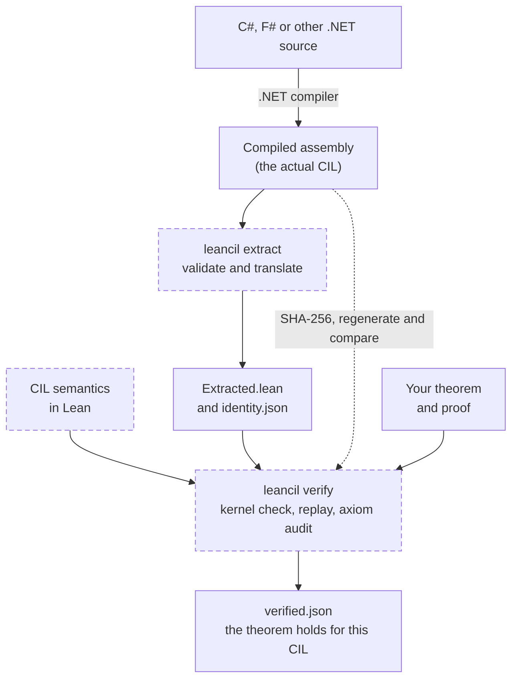

# LeanCIL: Formal Verification for .NET


LeanCIL uses Lean 4 to prove properties of compiled .NET code. It extracts Common Intermediate
Language (CIL) from assemblies written in C#, F# and other .NET languages, then checks proofs
against an explicit model of those instructions.

You can prove results for every input satisfying a contract, show that a loop terminates,
check memory access conditions, or establish a counterexample to an incorrect implementation.
Proofs can compose previously proved method contracts without unfolding helper bodies.

The [buffer-fill example](Examples/Proofs/FillWords.lean) proves an arbitrary-length fill,
including termination, the resulting contents and preservation outside the writable region.
The [span-content loop](Examples/Proofs/SpanAllZero.lean) proves whether every element is zero
over arbitrary-length symbolic caller storage, including termination and exact memory preservation.



The guarantee is exactly the proved theorem, including its preconditions and quantifiers.
Lean checks the proof, not whether its statement captures your intended specification.
The extractor, CIL model and verification machinery have an explicit
[trust boundary](docs/SOUNDNESS.md); LeanCIL does not claim complete CLR or JIT verification.

## Quick start

Install **Lean 4.35.0** through elan and **.NET SDK 10.0.403**, as pinned in
[lean-toolchain](lean-toolchain) and [global.json](global.json). From this checkout:

```sh
lake build
dotnet pack Extractor -c Release -o artifacts/packages
dotnet tool install --global Nethermind.LeanCIL --add-source artifacts/packages --version 0.1.0
dotnet build Examples/Assembly -c Release
```

The example assembly contains:

```csharp
public static ulong Add(ulong x, ulong y) => unchecked(x + y);
```

Extract its compiled instructions and check the supplied universal addition proof:

```sh
leancil extract Examples/Assembly/bin/Examples.dll "Arithmetic::Add(ulong,ulong)" artifacts/Add
leancil verify artifacts/Add --proof Examples/Proofs/Add.lean
```

Success prints `Verified: ExampleProof.correctness` and writes `artifacts/Add/verified.json`.
The theorem states that the result equals `(x + y) mod 2^64` for every pair of 64-bit inputs.
Changing the implementation to subtraction makes the unchanged proof fail.

The [getting-started walkthrough](docs/GETTING-STARTED.md) shows the expected output,
edit/rebuild/failure/recovery sequence, and a proof that an invalid memory access cannot succeed.
The [examples](docs/EXAMPLES.md) cover arithmetic, calls, structs, generic methods, loops,
memory access and compiled F#.

## Commands

| Command | Purpose |
| --- | --- |
| `leancil list` | Discover canonical method signatures in an assembly |
| `leancil extract` | Validate and translate a method and its reachable calls |
| `leancil check` | Check extraction artifacts against their assembly and settings |
| `leancil verify` | Check, kernel-replay and audit a named theorem |
| `leancil workspace` | Create an editable Lean proof workspace |
| `leancil verify-batch` | Verify multiple requests against one consumer snapshot |

`check` validates extraction consistency; `verify` establishes the selected theorem.
Failures return a nonzero exit code. See the [CLI reference](docs/CLI.md) for all commands,
profiles, saved settings and diagnostics.

## Consumer packages and batches

Keep application specifications and proofs in your own Lean package, with LeanCIL pinned as
a dependency. Methods can publish contracts for separately compiled callers; consumer proofs
can span multiple modules and share checked support across batch requests.

See [consumer packages and workspaces](docs/CONSUMERS.md),
[contract interfaces](docs/CONTRACT-INTERFACES.md) and [integration guidance](docs/MIGRATION.md).
Lake configuration and Lean elaborators execute code, so use packages you trust.

## Supported subset and limits

LeanCIL supports integer arithmetic, selected control flow and managed calls, reference-free
structs, checked memory access, and arrays and spans of integers, enums,
reference-free structs and supported integer vectors over supplied storage,
reference-free array allocation, typed managed dispatch, and selected runtime helpers and
SIMD intrinsics. Each has restrictions
documented in the [opcode support table](docs/OPCODES.md) and [intrinsic support tables](docs/SIMD.md).
Unsupported instructions and signatures are rejected explicitly.

The checked memory model tracks allocation identity, lifetime, bounds, permissions,
initialization and alignment. `CIL.Safety.invoke` is the execution model for both functional
correctness and memory-safety claims.

General class allocation and virtual dispatch, ordinary recursive calls, exception handlers,
floating-point arithmetic and arbitrary external calls are outside the supported subset.
Concurrency, GC implementation correctness and equivalence to arbitrary .NET runtimes are
outside the model's guarantees. See [soundness and limitations](docs/SOUNDNESS.md).

## Build and test

```sh
lake build
dotnet run --file scripts/Test.cs -- --suite core
```

Run `dotnet run --file scripts/Test.cs` for the full suite. Tests compile example assemblies,
check Lean proofs, exercise rejection cases and validate artifact identity. Results are written
to `artifacts/`. Use separate checkouts for concurrent suites because they mutate those files.
See [validation coverage and suite commands](docs/VALIDATION.md) and [CI operation](docs/CI.md).

## Documentation

| Topic | Guide |
| --- | --- |
| First proof and failure diagnostics | [Getting started](docs/GETTING-STARTED.md) |
| Proofs, contracts, loops and automation | [Writing proofs](docs/PROOFS.md) |
| Checking proofs against your library with a coding agent | [Agent skill](skills/leancil/SKILL.md) |
| Modules and proof APIs | [Architecture](docs/ARCHITECTURE.md) |
| Cross-assembly contracts | [Contract interfaces](docs/CONTRACT-INTERFACES.md) |
| Independently checking imported implementations | [Full verification](docs/FULL_VERIFICATION.md) |
| Runtime and architecture assumptions | [Runtime profiles](docs/RUNTIME-PROFILES.md) |
| Trusted components and guarantees | [Soundness](docs/SOUNDNESS.md) |
| Benchmarks and implementation investigations | [Performance](docs/performance/README.md) |

## License

Licensed under either [Apache-2.0](LICENSE-APACHE) or [MIT](LICENSE-MIT), at your option.
